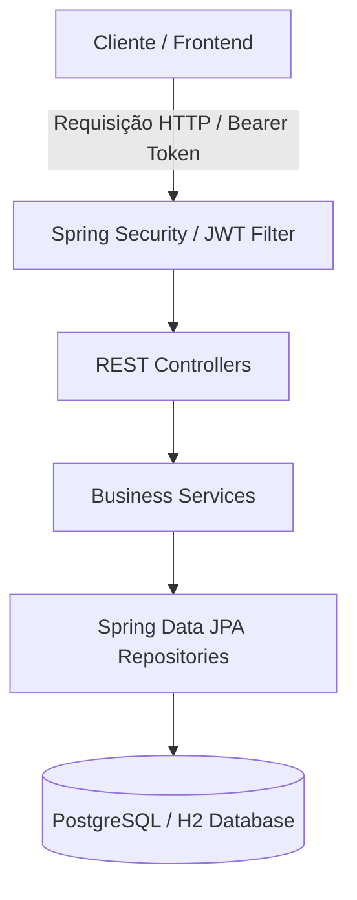

## Jecommerce - Spring Boot API 🚀
 

  
  
  

Plataforma corporativa de E-commerce desenvolvida com arquitetura robusta em Java 21 e Spring Boot 3.x, contendo infraestrutura containerizada via Docker Compose, segurança avançada com OAuth2/JWT e rigorosos padrões de testes automatizados.

-----

### 🎯 O Projeto
 
**O objetivo principal foi construir um modelo de domínio sólido, tratando relacionamentos complexos, segurança com **OAuth2/JWT** e garantindo a integridade referencial em um banco de dados relacional externo**.

### Modelo de Domínio e ORM
O sistema baseia-se em um modelo clássico de e-commerce:
 
* **User & Role:** Controle de acesso e perfis de usuário.

* **Product & Category:** Relacionamento muitos-para-muitos.

* **Order & OrderItem:** Gerenciamento de pedidos com chaves compostas *`(@EmbeddedId)`.*

* **Payment:** Registro de transações financeiras.

-----

### 🛠️ Tecnologias Utilizadas
 
* **Java 21 / Spring Boot 3.4.2**

* **Spring Data JPA** (Persistência)

* **Spring Security (OAuth2 & JWT)**

* **PostgreSQL** (Banco de Dados)

* **Docker & Docker Compose** (Containerização)

* **Postman** (Testes de API)

-----

### 🚀 Desafios Superados e Melhorias Técnicas(*Change Log*)
Diferente da versão inicial, o projeto evoluiu para resolver problemas reais de infraestrutura e código moderno:
 
#### 1. Migração para PostgreSQL via Docker

* Desafio: Conflitos de criação de banco e persistência entre o **Docker** e o **Spring**.

* Solução: - Implementação do `docker-compose.yml` para subir o container do **Postgres**.

* Criação manual do banco `jecommercedb` para isolar os metadados do container da aplicação.

* Configuração do `application-dev.properties` com `ddl-auto=none` para maior controle do esquema via scripts *SQL*.

#### 2. Correção de Named Parameters (*@Param*)

* Desafio: `Erro java.lang.IllegalStateException: For queries with named parameters you need to provide names`....
* Solução: Com a atualização para o **Spring Boot 3.2+**, o compilador **Java** pode omitir nomes de parâmetros. A solução foi tornar explícito o mapeamento nos *Repositories*:

#### 3. Otimização do Repositório (*Git*)

* Desafio: Lentidão e arquivos pesados devido ao rastreamento da pasta de dados do **Docker** (.`data/`).
* Solução: Configuração rigorosa do `.gitignore` e limpeza do cache do **Git** para manter o repositório leve, contendo apenas código-fonte.

#### 4. Bean Validation & Custom Errors

Diferente de erros genéricos, implementamos um sistema que captura falhas de validação e retorna o status **422 Unprocessable Entity**, listando exatamente qual campo falhou e por quê. As classes `ValidationError` e `FieldMessage` foram fundamentais para essa estética de resposta.

#### 5. 🛠️ Decisões de Arquitetura e Engenharia

* **Problema Resolvido:** Implementação de uma API REST corporativa para gerenciamento completo de e-commerce (usuários, produtos, categorias, pagamentos e ordens de compra), aplicando princípios SOLID, Domain-Driven Design (DDD) e tratamento de concorrência transacional.
* **Segurança:** Autenticação e autorização *stateless* baseada em tokens **JWT (JSON Web Token)** com controle granular de acessos por perfis (**RBAC - Role-Based Access Control**) e criptografia de credenciais via BCrypt.
* **Resiliência e Tratamento de Erros:** Arquitetura centralizada de exceções customizadas via `@ControllerAdvice`, garantindo respostas padronizadas e descritivas para falhas de validação, integridade de banco e regras de negócio.
* **Qualidade de Software (Testes):** Suíte estruturada de **Testes Unitários** (com JUnit 5 e Mockito), **Testes de Integração** (validando controladores, segurança e persistência) e cobertura **JaCoCo**.

-----

### 📡 **Endpoints da API** (Testes via Postman)

Abaixo estão os principais pontos de acesso. Utilize o *Bearer Token* após o *login* para rotas protegidas.

#### 🔑 **Autenticação**

* **POST** `/oauth2/token` -> *Login* e geração de *Token JWT*.

#### 📦 Produtos (*Products*)

* **GET** `/products` -> Listagem paginada de produtos.

* **GET** `/products/{id}` -> Detalhes de um produto específico.

* **POST** `/products` -> Inserção de novo produto (Requer privilégios ADMIN).

#### 👥 Usuários (Users)

* **GET** `/users/me`-> Perfil do usuário logado (autenticado).

* **POST** `/users` -> Cadastro de novos clientes.

-----

### 🧪 Processo de Homologação (Passo a Passo)

1. **Subir Container**: `docker-compose up -d`

2. **Preparar Banco**: Criar o banco *jecommercedb* via pgAdmin no servidor local.

3. **Execução**: Rodar a aplicação no **STS** no profile `dev`.

4. **Validação**: Realizar chamadas no *Postman* e verificar se os dados refletem corretamente no *pgAdmin*.

-----

### ⚙️ Como Executar o Projeto

1. **Subir o Banco de Dados**:
Certifique-se de ter o Docker instalado e rode: `docker-compose up -d`

2. **Configurar o Banco no pgAdmin**:
* Crie o banco de dados chamado jecommercedb no servidor localhost:5432.
* Use `create.sql` em *Tables* com Query *Tool para povoar* o *db*

3. **Rodar a Aplicação**:
Importe o projeto no **STS** (Spring Tool Suite) e execute como Spring Boot App.

4. **Testar no Postman**:

* Realize o login em POST /oauth2/token para obter o Bearer Token.

* Utilize o token para acessar os demais endpoints protegidos.

-----

## 📚 API Documentation

The **JeCommerce** API is fully documented using OpenAPI 3 (SpringDoc) and integrated with a professional developer portal on Readme.com.

* **Interactive Developer Portal (Readme.com):** [JeCommerce API Reference](https://jecommerce.readme.io/)[cite: 9]// but it is not free after 14 days
* **Local Swagger UI:** `http://localhost:8080/swagger-ui/index.html` (Available when running the application locally)

-----
###✨ Próximos Passos

* **DEPLOY**: Preparar o `Dockerfile` para ambiente de produção

* **Testes Automatizados**: Implementar testes de API *Rest Assured*
