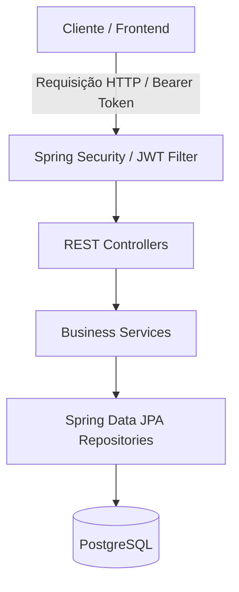

# JeCommerce - API REST de E-commerce com Spring Boot, OAuth2/JWT e PostgreSQL

<p align="center">
  
  
  
  
  
</p>

API REST de e-commerce desenvolvida com **Java 21** e **Spring Boot 3.4**, em arquitetura em camadas, com **PostgreSQL** em container (Docker Compose), autenticação **OAuth2/JWT** e testes automatizados.

O projeto parte da trilha prática da **DevSuperior** e foi evoluído de forma incremental com implementações próprias (infraestrutura com Docker, validação, tratamento de erros, documentação OpenAPI e testes).

> **Uso de IA:** utilizei IA como apoio para investigar problemas, refatorar e construir testes. As sugestões foram avaliadas e validadas com a leitura do código e com a execução dos testes.

---

## 🎯 O Projeto

O objetivo foi construir um modelo de domínio sólido, lidando com relacionamentos complexos entre entidades, segurança com **OAuth2/JWT** e integridade referencial em um banco relacional (PostgreSQL).

### Modelo de Domínio

* **User e Role:** usuários e perfis de acesso.
* **Product e Category:** relacionamento muitos-para-muitos.
* **Order e OrderItem:** pedidos e itens, com chave composta (`@EmbeddedId`).
* **Payment:** registro do pagamento de um pedido.

### Arquitetura (visão geral)



---

## 🛠️ Tecnologias Utilizadas

* **Java 21** e **Spring Boot 3.4.2**
* **Spring Data JPA** (persistência)
* **Spring Security** (OAuth2 e JWT)
* **PostgreSQL** (banco de dados)
* **Docker e Docker Compose** (banco em container)
* **Bean Validation** (validação de entrada)
* **JUnit 5, Mockito e JaCoCo** (testes e cobertura)
* **SpringDoc** (OpenAPI 3 / Swagger UI)
* **Postman** (testes manuais da API)

---

## 🧱 Decisões de Arquitetura e Engenharia

* **Segurança:** autenticação e autorização *stateless* com **JWT**, controle de acesso por perfis (**RBAC**, ex.: ADMIN e cliente) e senhas com **BCrypt**.
* **Tratamento de erros:** exceções centralizadas com `@ControllerAdvice`, que devolvem respostas padronizadas para falhas de validação, integridade de dados e regras de negócio.
* **Validação:** **Bean Validation**, com resposta **422 Unprocessable Entity** que informa qual campo falhou e o motivo (classes `ValidationError` e `FieldMessage`).
* **Banco de dados:** perfil `dev` com `ddl-auto=none`, e esquema criado por scripts SQL, para ter controle sobre a estrutura das tabelas.
* **Testes:** testes unitários (JUnit 5 e Mockito) e testes de integração (controladores, segurança e persistência), com cobertura medida pelo **JaCoCo**.

---

## 🚀 Desafios Superados e Melhorias Técnicas (*Change Log*)

### 1. Migração para PostgreSQL com Docker
* **Desafio:** conflitos de criação do banco e de persistência entre o Docker e o Spring.
* **Solução:**
  * `docker-compose.yml` para subir o container do PostgreSQL.
  * Criação manual do banco `jecommercedb`, separando os metadados do container dos dados da aplicação.
  * `application-dev.properties` com `ddl-auto=none`, com o esquema controlado por scripts SQL.

### 2. Parâmetros nomeados em consultas (`@Param`)
* **Desafio:** erro `java.lang.IllegalStateException: For queries with named parameters you need to provide names`.
* **Causa:** a partir do Spring Boot 3.2, o nome dos parâmetros do método pode não estar disponível em tempo de execução.
* **Solução:** declarar o nome explicitamente com `@Param` nos repositórios. Exemplo ilustrativo:

```java
@Query("SELECT obj FROM Product obj WHERE UPPER(obj.name) LIKE UPPER(CONCAT('%', :name, '%'))")
Page<Product> searchByName(@Param("name") String name, Pageable pageable);
```

### 3. Repositório Git leve
* **Desafio:** lentidão e arquivos pesados por causa do rastreamento da pasta de dados do Docker (`.data/`).
* **Solução:** `.gitignore` ajustado e limpeza do cache do Git, mantendo no repositório só o código-fonte.

### 4. Bean Validation e respostas de erro customizadas
* **Desafio:** devolver erros de validação claros em vez de mensagens genéricas.
* **Solução:** captura das falhas de validação com resposta **422**, listando o campo e o motivo de cada erro (`ValidationError` e `FieldMessage`).

---

## 📡 Endpoints Principais

Use o *Bearer Token* obtido no login nas rotas protegidas. A lista completa está na documentação OpenAPI (seção abaixo).

| Método | Rota | Descrição | Acesso |
|---|---|---|---|
| `POST` | `/oauth2/token` | Login e geração do token JWT | Público |
| `GET` | `/products` | Lista paginada de produtos | Público |
| `GET` | `/products/{id}` | Detalhes de um produto | Público |
| `POST` | `/products` | Cadastro de produto | ADMIN |
| `GET` | `/users/me` | Perfil do usuário autenticado | Autenticado |
| `POST` | `/users` | Cadastro de cliente | Público |

<!-- TODO: confira a coluna "Acesso" com o que está configurado na sua classe de segurança (ResourceServerConfig)
     e ajuste se algum endpoint tiver regra diferente. -->

---

## ⚙️ Como Executar

**Pré-requisitos:** JDK 21, Docker e Docker Compose.

1. **Subir o banco de dados**
   ```bash
   docker-compose up -d
   ```
2. **Preparar o banco (pgAdmin)**
   * Crie o banco `jecommercedb` no servidor `localhost:5432`.
   * No *Query Tool*, execute o script `create.sql` para criar e popular as tabelas.
3. **Executar a aplicação** com o profile `dev`, no STS (como *Spring Boot App*) ou pelo terminal:
   ```bash
   ./mvnw spring-boot:run -Dspring-boot.run.profiles=dev
   ```
4. **Testar no Postman**
   * Faça o login em `POST /oauth2/token` para obter o *Bearer Token*.
   * Use o token nas rotas protegidas e confira os dados no pgAdmin.

### Testes e cobertura

```bash
./mvnw clean verify
```

<!-- TODO: informe o caminho do relatório do JaCoCo neste projeto (ex.: target/site/jacoco/index.html)
     e, quando a cobertura voltar a 100% após os incrementos, acrescente a frase com o mês da medição. -->

---

## ⚙️ Variáveis de Ambiente

<!-- TODO: liste aqui as variáveis que o projeto lê (nomes exatos do application.properties), com valores de EXEMPLO,
     por exemplo: usuário/senha do banco, client id/secret do OAuth2 e duração do token. Nunca coloque valores reais. -->

---

## 📚 Documentação da API

A API é documentada com **OpenAPI 3 (SpringDoc)**, com suporte a autenticação **JWT Bearer** na interface do Swagger.

* **Swagger UI (local):** `http://localhost:8080/swagger-ui/index.html` (com a aplicação em execução)
* **Portal de documentação (Readme.com):** [Referência da API do JeCommerce](https://jecommerce.readme.io/)

<!-- Sugestão: adicione um print da tela do Swagger UI, por exemplo:  -->

---

## ✨ Próximos Passos

* **Deploy:** preparar o `Dockerfile` para ambiente de produção.
* **Testes:** ampliar os testes de API e recompor a cobertura do JaCoCo após os novos incrementos.

---

## 👤 Autor

**Jeferson Martins** - Desenvolvedor Backend Java Júnior
[LinkedIn](https://www.linkedin.com/in/jeferson-martins-48b9b690) | [GitHub](https://github.com/J3f3r)